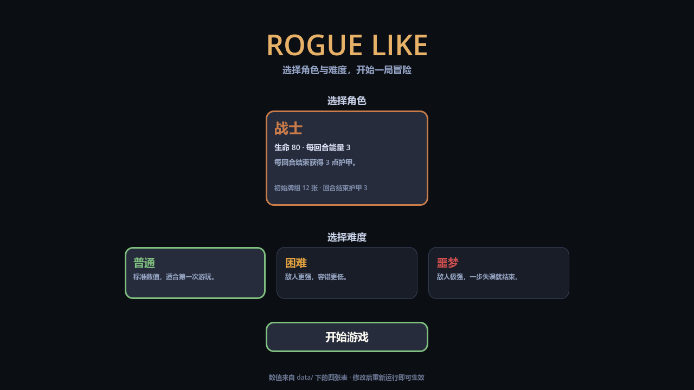
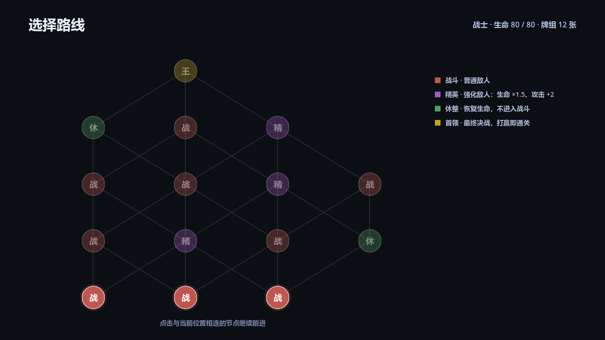
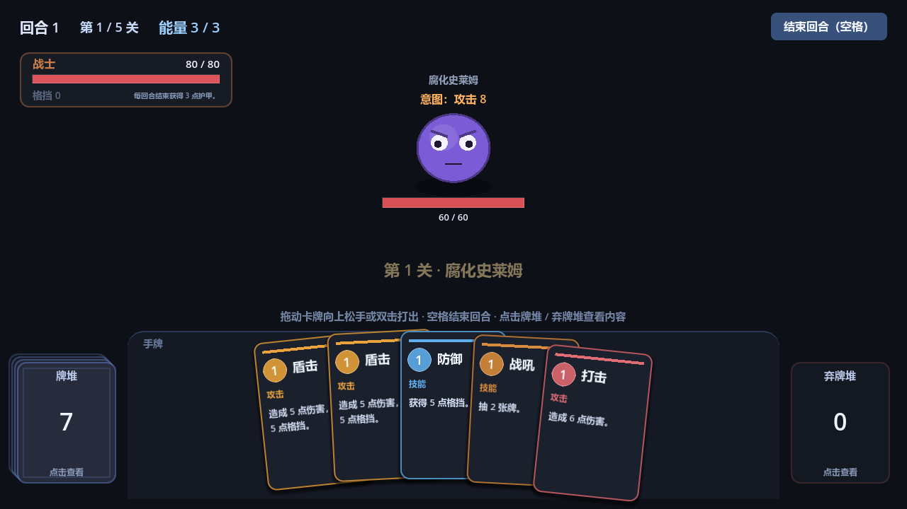
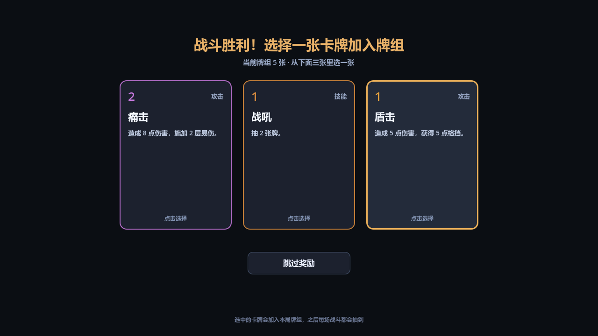

# ROGUE LIKE

一个用 Godot 4.6 制作的卡牌 Roguelike 原型：分支地图选路、回合制卡牌战斗、角色与难度选择、战斗后三选一奖励。



## 玩法

1. **主界面**：选择角色（战士）与难度（普通 / 困难 / 噩梦），不同难度下怪物数值不同。
2. **分支地图**：每层有多个节点，只能沿着连线前进。
   - 战斗：普通敌人
   - 精英：敌人生命 ×1.5、攻击 +2
   - 休整：恢复生命，不进入战斗
   - 首领：最终决战，击败即通关
3. **战斗**：每回合 3 点能量、抽 5 张牌，拖到上方或双击出牌，空格结束回合。
4. **奖励**：每次战斗胜利后从三张牌中选一张加入本局牌组，也可以跳过。



## 已实现的机制

- 卡牌效果：伤害、格挡、抽牌、获得能量、易伤、力量
- 关键词：
  - **力量**：每点力量让攻击牌伤害 +1，本场战斗生效
  - **能力**：打出后进入坟场（不进弃牌堆），效果持续整场战斗；坟场中的牌不会洗回牌堆
- 牌堆 / 弃牌堆 / 坟场均可点击查看内容
- 角色被动：战士每回合结束获得 3 点护甲
- 回合制敌人：固定攻击循环、意图提示、易伤、受击与死亡动画
- 战斗后选牌奖励，牌组在整局内累积





## 运行

1. 安装 Godot 4.6（.NET 版也可，目前只用到 GDScript）。
2. 用 Godot 打开本目录的 `project.godot`，按 F5 运行。

## 数值表（重点）

游戏的卡牌、角色、难度、怪物、地图路线全部来自 `data/` 下的四张 Excel，**游戏直接读取 xlsx，不需要导出 CSV**。改完保存、重新运行即可生效。

| 文件 | 内容 |
|---|---|
| `data/cards.xlsx` | 卡牌：费用、伤害、格挡、抽牌、能量、易伤、力量、每回合能量、归属（通用/角色专属） |
| `data/characters.xlsx` | 角色：生命、能量、回合结束护甲、起始手牌、起始牌组、主题色 |
| `data/levels.xlsx` | 难度列表 + 每个难度下每层的怪物数值 + 全局设置 |
| `data/map.xlsx` | 地图节点：层、列、类型；连线按列差自动生成 |

每张表都带一个「说明」工作表，写明了列的含义与修改方法。

> 导出成可执行文件时，需要在「导出 → 资源 → 导出非资源文件过滤器」里加上 `*.xlsx`，否则打包后的游戏读不到数值表。

## 目录结构

```
Cards/            卡牌场景与数据
  cards.gd        单张卡牌的显示、拖拽、动画
  card_data.gd    卡牌数据 Resource
  card_library.gd 从数值表生成牌组 / 奖励池
Scence/           场景与主要逻辑
  game.gd         主流程：地图 ↔ 战斗、结算、奖励
  map_view.gd     地图绘制与点击
  menu_view.gd    主界面
  reward_view.gd  三选一奖励
  enemy.gd        敌人表现与状态
  hand.gd         手牌排版
  pile_ui.gd      牌堆 / 弃牌堆 / 坟场
  xlsx_reader.gd  xlsx 解析
  game_data.gd    读取并缓存四张表
data/             四张数值表
docs/             截图
```

## 待办 / 可扩展方向

- 商店、事件、宝箱节点
- 卡牌升级与稀有度
- 更多角色与专属卡池
- 存档与进度继承
